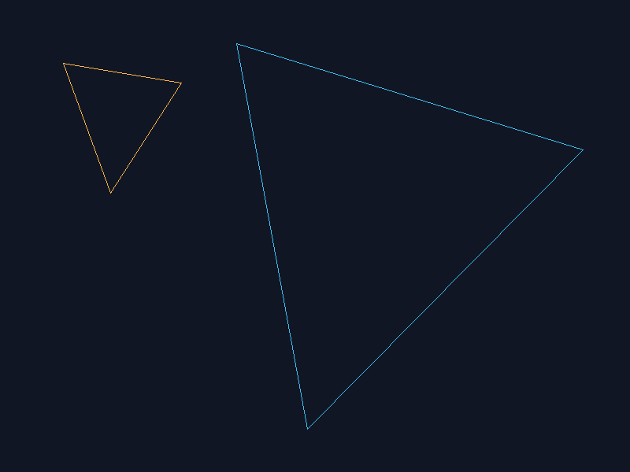

# Laboratorio: Rellenar triángulos (Rust + Raylib)

## Requisitos
- Rust + Cargo instalados.
- Dependencias declaradas en `Cargo.toml` (`raylib 6.0`, `image 0.25`).
- En algunos sistemas, Raylib necesita compilador C/CMake y bibliotecas gráficas del sistema.

## Ejecutar
```bash
cargo run --release
```

**Controles:** `Q` contorno (Wireframe), `W` baricéntricas, `E` scanline, `1`-`6` cambiar prueba, `S` guardar PNG en `capturas/`.

## Casos de prueba
1. Triángulo pequeño y grande.
2. Arista horizontal y arista vertical.
3. Tres vértices en orden original.
4. Los mismos vértices en orden invertido.
5. Triángulo parcialmente fuera de la imagen.
6. Triángulo degenerado (vértices colineales).

Comprobar que los rellenos devuelven los mismos píxeles:
```bash
cargo test
```
En cada cambio de modo/escena se imprime en consola si ambas implementaciones coinciden.

## Mediciones
La comparación en modo optimizado, sin abrir ventana, toma **9 muestras** de **100 ejecuciones** para cada algoritmo, informa la **mediana** y cuenta los fragmentos:
```bash
cargo run --release -- --measure
```
No incluye actualización de textura ni dibujo. Usa `Instant` y `black_box`.

| Algoritmo | Fragmentos | Mediana de 100 ejecuciones | Tiempo medio por ejecución |
|---|---:|---:|---:|
| Baricéntrico | 582,757 | 1.161 s | 11.615 ms |
| Scanline | 582,757 | 0.879 s | 8.790 ms |

Comparación exacta: **IGUALES** (ambos algoritmos producen exactamente los mismos 582,757 fragmentos en los casos de prueba).

## Perfilador
Instalar `cargo-flamegraph` si es necesario:
```bash
cargo install flamegraph
```
En Windows, abrir PowerShell **como administrador** y ejecutar desde la carpeta del proyecto:
```bash
cargo flamegraph --release --output flamegraph.svg -- --benchmark-triangles
```
Esto genera `flamegraph.svg`. El modo `--benchmark-triangles` hace 1200 iteraciones por algoritmo sin abrir la ventana. En Windows, la captura nativa usa `blondie` y falla con `NotAnAdmin` si la consola no tiene elevación.

## Regla de cobertura
Ambos algoritmos evalúan el centro `(x + 0.5, y + 0.5)`. Se **incluye el borde** del triángulo. El baricéntrico usa pruebas de signo de las tres áreas orientadas. Internamente utiliza coordenadas duplicadas enteras para evitar errores de coma flotante y funciona con cualquier orientación de vértices.

El scanline intersecta cada fila con las aristas usando una regla semiabierta `[y_min, y_max)` para no contar dos veces un vértice; luego verifica con la misma prueba exacta de interior los píxeles cercanos a los extremos. Las aristas horizontales no producen intersecciones porque la fila se evalúa en un centro `y + 0.5`. Un triángulo con área cero no genera relleno. El contorno puede dibujar segmentos degenerados.

## Resultados y análisis
1. **Capturas generadas:**
   - Contorno:
     
   - Relleno baricéntrico:
     
   - Relleno scanline:
     
2. **Pruebas automáticas:**
   - `cargo test`: comprueba el triángulo degenerado, los pesos baricéntricos, la equivalencia exacta de fragmentos y que invertir los vértices no cambie la cobertura.
3. **Análisis de rendimiento:**
   - **Baricéntrico (11.615 ms / muestra):** Itera sobre todo el *bounding box* rectangular 2D del triángulo y evalúa la función de orientación para cada centro `(x + 0.5, y + 0.5)`. Realiza trabajo inútil evaluando píxeles en las esquinas del rectángulo fuera del triángulo.
   - **Scanline (8.790 ms / muestra):** Procesa fila por fila, hallando directamente los puntos de intersección con las aristas `[left, right]` y recortando drásticamente el espacio de búsqueda horizontal. Resultó aproximadamente un **24.3% más rápido** en esta ejecución, aunque el tiempo exacto depende del equipo.
   - El `flamegraph.svg` permitirá comprobar cuánto tiempo corresponde a los cálculos geométricos y cuánto al crecimiento de `Vec<Fragment>`; no debe afirmarse esa distribución sin ejecutar primero el perfilador.

## Organización
- `src/main.rs`: ventana, framebuffer, PNG y benchmark.
- `src/rasterizer.rs`: triángulos, fragmentos, los tres modos y pruebas automáticas.
- `src/scenes.rs`: triángulos de prueba.
